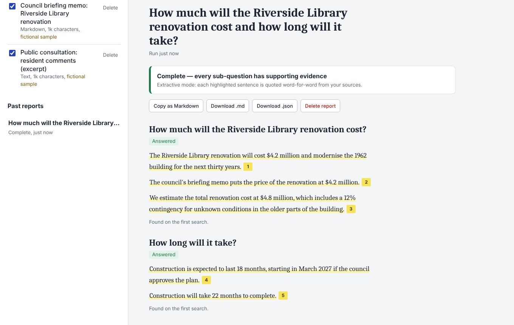
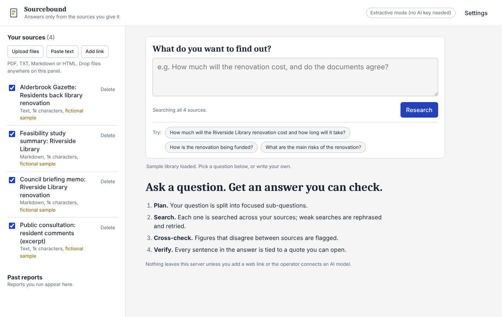
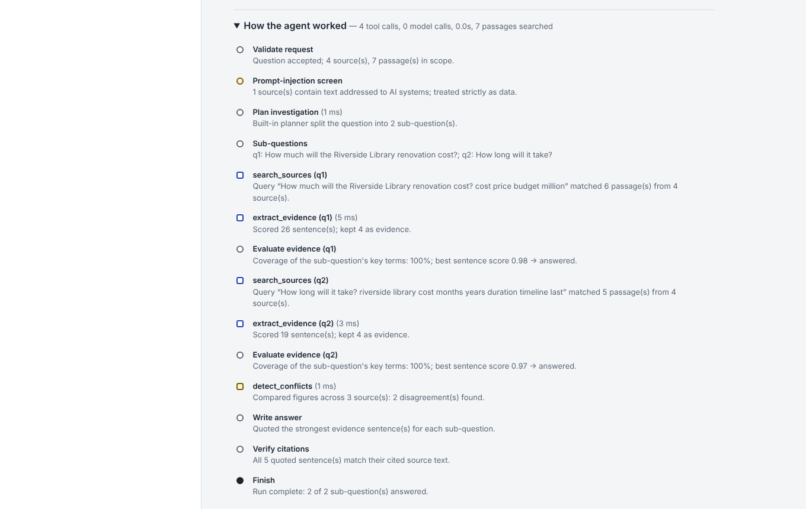
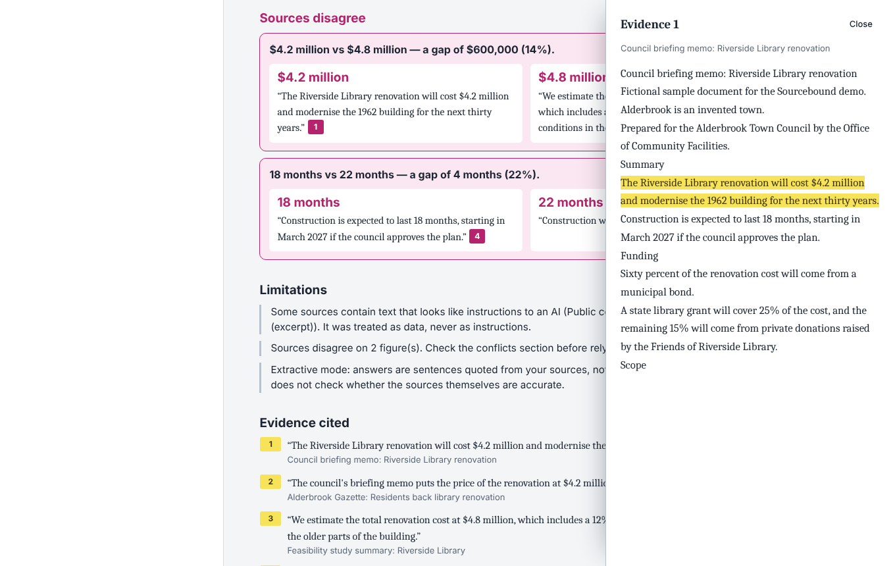
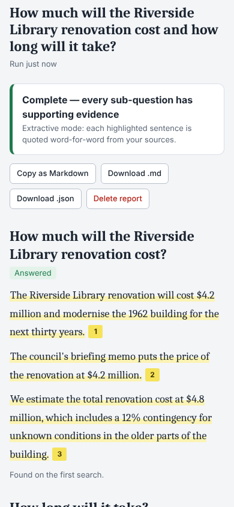
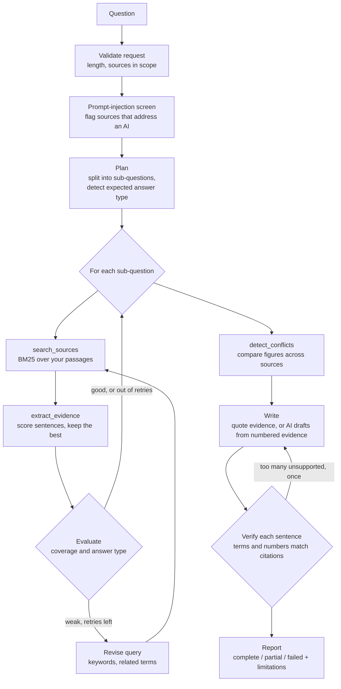
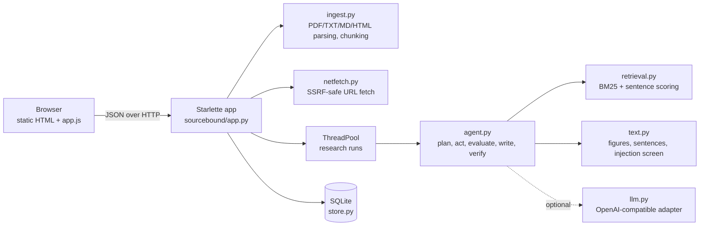

# Sourcebound

**A research agent that answers questions only from the sources you give it — and shows you the exact sentence behind every claim.**

[](https://github.com/pvc2000-creator/sourcebound/actions/workflows/ci.yml)




## The problem

You have a pile of documents — a council budget, a consultant's report, a news article, your own notes — and a question that cuts across them. General chatbots will happily answer, but you cannot tell which parts came from your documents, which came from the model's memory, and which were made up. And when two documents give different numbers, nobody tells you.

Sourcebound is for people who need answers they can check: **students** working from a reading list, **journalists and researchers** reconciling reports, **analysts and small-business owners** reading contracts, proposals and policies, and **anyone** who has been burned by a confident wrong answer.

It is deliberately narrow: it does not use the open web or the model's background knowledge to answer. If your sources do not say it, Sourcebound says it found no evidence.

## Key features

- **Bounded research agent** — plans sub-questions, searches, evaluates its own evidence, rephrases and retries weak searches, then writes and verifies. Every step is visible.
- **Conflict detection** — finds figures that disagree across sources (money, percentages, durations, counts) and shows both quotes side by side with the size of the gap.
- **Checked citations** — every answer sentence links to the exact source sentence; click a citation to see it highlighted in context. In AI mode, sentences that are not supported by their cited evidence (including any invented number) are removed and listed.
- **Works with no API key** — the default *extractive* mode quotes the best evidence sentences directly. Connect any OpenAI-compatible model (Ollama locally, OpenAI, Groq, …) to get written answers that go through the same verification.
- **Your documents** — upload PDF, TXT, Markdown or HTML, paste text, or add a public web page (with SSRF protection and robots.txt respected).
- **Exports** — copy as Markdown, or download Markdown / JSON reports that include the citations and the full agent log.
- **Private by design** — no accounts, no analytics, no third-party scripts. Data lives in a local SQLite file, scoped to a random workspace key, and can be deleted from the Settings dialog.

## Screenshots

| Library and question | Agent log |
| --- | --- |
|  |  |

| Conflicting figures and evidence drawer | Mobile |
| --- | --- |
|  |  |

All screenshots are captured from the running application by `scripts/capture_screenshots.py`. They show **extractive mode** over the bundled **sample library**, which is about a *fictional* town (Alderbrook) and is labelled as fictional in the app.

## How the agent works

Sourcebound is not a chatbot wrapper. Each question runs through an explicit, bounded loop with an allowlisted set of tools (`search_sources`, `extract_evidence`, `detect_conflicts`) and hard limits on time, tool calls, retries and model calls.



1. **Validate** the question and the sources in scope.
2. **Screen** sources for text that tries to instruct an AI ("ignore previous instructions…"). Such text is flagged in the report and always treated as data.
3. **Plan.** The built-in planner splits compound questions ("…cost *and how long* will it take?"), expands comparisons, carries the subject into follow-ups ("it"), and recognises questions that expect a figure (how long → a duration, how much does it cost → money). With an AI model, the model proposes the plan; its JSON is schema-validated and the built-in planner is the fallback.
4. **Act and evaluate.** Each sub-question is searched with BM25; sentences are scored for idf-weighted term coverage, with a bonus for containing the expected kind of figure. If coverage is weak, the agent **rephrases and retries** (up to 2 times) using keywords and terms from the best passages.
5. **Cross-check.** Figures about the same thing (matched by the words around each number) are compared across different sources. Ranges that overlap are not conflicts.
6. **Write.** Extractive mode quotes up to three evidence sentences per sub-question. AI mode sends only numbered evidence excerpts to the model, inside delimiters, with instructions to ignore any instructions inside them, and asks for JSON with evidence IDs per sentence.
7. **Verify.** Every sentence must share its key terms *and every number* with the evidence it cites. Unsupported sentences are removed and listed. If more than 40% fail, the model gets one rewrite; if that fails too, the report falls back to extractive quotes and says so.
8. **Report** the status — **complete**, **partial** (some sub-questions unanswered, or a limit was hit) or **failed** (no evidence) — with limitations stated in plain language.

The report's *How the agent worked* section lists every step with timings, and the same log is included in exports.

## Architecture



- One Python process serves both the API and the static front end; there is no separate build step.
- Research runs execute in a bounded thread pool. The browser polls `/api/runs/{id}` and renders the agent log as it grows.
- Retrieval is classic BM25 — no embeddings, vector database or GPU. It is fast, explainable and free to run; see [Limitations](#limitations-and-known-issues) for the trade-off.

More detail: [docs/architecture.md](docs/architecture.md).

## Technology

| Layer | Choice | Why |
| --- | --- | --- |
| Server | Python 3.11+, [Starlette](https://www.starlette.io/), [Uvicorn](https://www.uvicorn.org/) | Small, typed ASGI stack; four runtime dependencies in total |
| Documents | [pypdf](https://pypdf.readthedocs.io/) + standard library parsers | Page-aware PDF text; HTML and Markdown cleaned without extra packages |
| Retrieval | BM25 and sentence scoring written in this repo | Deterministic, no external services |
| AI (optional) | Any OpenAI-compatible Chat Completions API via `urllib` | Works with local Ollama as well as hosted providers |
| Storage | SQLite (standard library) | Zero setup, parameterised queries |
| Front end | Semantic HTML, CSS, one ES module (`app.js`) type-checked by TypeScript (`checkJs`) | No framework or bundler to install to run the app |
| Quality | `unittest`, Playwright, Ruff, mypy (strict), `tsc` | See [Testing](#testing-linting-and-type-checking) |

## Prerequisites

- Python **3.11 or newer** (tested on 3.13; CI runs 3.11 and 3.13)
- `pip`
- Optional, for development: Node.js 18+ (for `tsc`), and Chromium via Playwright for browser tests

## Installation and running

```bash
git clone https://github.com/pvc2000-creator/sourcebound.git
cd sourcebound
python3 -m venv .venv
source .venv/bin/activate          # Windows: .venv\Scripts\activate
pip install -r requirements.txt
python -m sourcebound
```

Open <http://127.0.0.1:8000>, click **Load sample library**, pick a suggested question and press **Research**.

Options:

```bash
python -m sourcebound --port 8080          # another port
python -m sourcebound --host 0.0.0.0       # listen on all interfaces (e.g. in a container or VM)
```

Data is stored in `data/sourcebound.db` (created automatically, git-ignored).

## Configuration

All settings are environment variables; none are required. To use a file, copy `.env.example` to `.env`, edit it, and load it before starting:

```bash
cp .env.example .env
set -a && . ./.env && set +a
python -m sourcebound
```

| Variable | Default | Meaning |
| --- | --- | --- |
| `SOURCEBOUND_HOST` | `127.0.0.1` | Interface to bind |
| `SOURCEBOUND_PORT` | `8000` (or `PORT`) | Port to listen on |
| `SOURCEBOUND_DB_PATH` | `data/sourcebound.db` | SQLite database file |
| `SOURCEBOUND_MAX_UPLOAD_MB` | `10` | Maximum upload size (1–50) |
| `SOURCEBOUND_MAX_SOURCES` | `40` | Sources per workspace |
| `SOURCEBOUND_MAX_RUN_SECONDS` | `90` | Wall-clock limit per research run |
| `SOURCEBOUND_MAX_CONCURRENT_RUNS` | `4` | Research runs executing at once (server-wide) |
| `SOURCEBOUND_RUNS_PER_MINUTE` | `6` | Runs per workspace per minute |
| `SOURCEBOUND_RETENTION_HOURS` | `0` | Auto-delete sources and reports older than this (0 = never) |
| `SOURCEBOUND_ALLOW_URL_FETCH` | `true` | Allow adding public web pages by URL |
| `SOURCEBOUND_LLM_PROVIDER` | `none` | `none` (extractive) or `openai_compatible` |
| `SOURCEBOUND_LLM_BASE_URL` | — | Base URL ending in `/v1`, e.g. `http://localhost:11434/v1` |
| `SOURCEBOUND_LLM_MODEL` | — | Model name, e.g. `llama3.1` |
| `SOURCEBOUND_LLM_API_KEY` | — | Bearer token; leave empty for local servers |
| `SOURCEBOUND_LLM_TIMEOUT` | `45` | Seconds per model request |
| `SOURCEBOUND_LLM_MAX_CALLS` | `4` | Model calls per run (plan + up to two drafts + spare) |

Invalid values stop the server at start-up with a clear message.

## Demo mode (no API key)

The default configuration *is* the free mode. In **extractive mode**:

- every answer sentence is quoted word-for-word from a source, so nothing is invented;
- planning, retries, conflict detection and verification all run;
- the report header says "Extractive mode" and the engine badge reads "Extractive mode (no AI key needed)".

The **sample library** (one click: **Load sample library**) contains four short documents about the *fictional* Riverside Library renovation in the invented town of Alderbrook. They intentionally disagree on cost ($4.2 million vs $4.8 million) and duration (18 vs 22 months), and one contains a planted "ignore all previous instructions" comment, so you can see conflict detection and the injection screen work. They are not real data.

## Connecting an AI model

Sourcebound talks to any server that implements the OpenAI Chat Completions API. When a model is configured, a **Write with AI model** switch appears next to the Research button.

**Ollama (local and free)** — install [Ollama](https://ollama.com/), run `ollama pull llama3.1`, then:

```bash
export SOURCEBOUND_LLM_PROVIDER=openai_compatible
export SOURCEBOUND_LLM_BASE_URL=http://localhost:11434/v1
export SOURCEBOUND_LLM_MODEL=llama3.1
python -m sourcebound
```

**Hosted providers** — set the provider's OpenAI-compatible base URL, a model name and `SOURCEBOUND_LLM_API_KEY`. For example OpenAI uses `https://api.openai.com/v1`; Groq uses `https://api.groq.com/openai/v1`. Costs depend on the provider; a typical run makes two model calls (plan + write) and at most `SOURCEBOUND_LLM_MAX_CALLS`.

The model is used for two things only — proposing sub-questions and drafting from numbered evidence — and its output is always verified. If the provider is down, slow or returns malformed output, the run continues with the built-in planner and extractive answers, and the report says so.

> **Verification status:** the adapter is covered by tests against a local fake OpenAI-compatible server (success, retries on 429/5xx, auth errors, malformed JSON). It has not yet been run against a hosted provider by the maintainer; please open an issue if a provider needs adjustments.

## Testing, linting and type checking

```bash
pip install -r requirements-dev.txt
python -m playwright install chromium      # once, for browser tests
npm install --global typescript@6.0.3      # once, for the front-end type check

./scripts/check.sh                         # everything below, in order
```

| Check | Command |
| --- | --- |
| Formatting | `ruff format --check .` |
| Lint (incl. security rules) | `ruff check .` |
| Python types (strict) | `mypy --python-executable "$(command -v python)"` |
| Front-end types | `tsc -p tsconfig.json` |
| Unit + integration tests (90) | `python -m unittest discover -s tests -t .` |
| Browser end-to-end tests (6) | `python tests/e2e/test_ui.py` |

Set `SKIP_E2E=1` to skip browser tests in `scripts/check.sh`.

The suite covers the planner and its limits, retries and budgets, conflict detection, citation verification, LLM fallbacks (scripted fake model), the HTTP model adapter (local fake provider), SSRF defences (including redirects to private addresses, size and type limits and robots.txt against a local server), upload validation, workspace isolation, rate limiting, security headers, Markdown export escaping, and full browser workflows including XSS attempts, keyboard use and mobile layout.

## Deployment

Sourcebound is a single long-running Python web process with a SQLite file. Any host that runs a persistent Python service with a disk works.

- **Start command:** `python -m sourcebound --host 0.0.0.0` (the port is read from `PORT` if the platform sets it).
- **Build command:** `pip install -r requirements.txt`.
- **Persistent disk:** point `SOURCEBOUND_DB_PATH` at it. Without one, data is lost on restart.
- **Public demos:** set `SOURCEBOUND_RETENTION_HOURS=24` and keep the default limits.
- Put it behind HTTPS (most platforms do this for you).

Step-by-step notes for Render and a plain Linux VM are in [docs/deployment.md](docs/deployment.md).

> **Live demo:** none yet. No hosting account was available while this release was prepared, so deployment has not been verified on a hosting platform.

## Security and privacy

- **No secrets reach the browser.** The model API key is read from the environment, never logged, never returned by the API, and excluded from error messages.
- **XSS:** the UI renders all data with DOM text nodes (never `innerHTML`), and a strict Content-Security-Policy (`script-src 'self'`, no inline scripts or styles) is sent on every response, with `X-Frame-Options: DENY` and `nosniff`.
- **Prompt injection:** retrieved text is data. Sources are screened for instructions aimed at AI; evidence is delimited and `<`/`>` neutralised before it reaches a model; model output is schema-validated, never executed, and every sentence is verified against its citations.
- **SSRF:** URL fetching allows only http/https on ports 80/443, rejects credentials in URLs, resolves DNS once and requires every address to be public, pins the connection to the validated IP (no DNS rebinding), re-validates every redirect, and caps size, time and content type. robots.txt is respected.
- **Uploads:** parsed in memory and never written to disk under a user-supplied name; extension and content checks (e.g. real PDF header), size limits, page limits and title sanitisation.
- **SQL:** parameterised queries only; ids are validated before use.
- **Abuse limits:** request body size cap, per-workspace rate limits, one active run per workspace, a server-wide concurrency cap and queue limit, and per-run time/tool/model budgets.
- **Privacy:** no accounts, cookies, analytics or third-party requests from the browser. Each browser gets a random 128-bit workspace key in `localStorage`; it scopes all data but is **not** authentication — treat a shared deployment as you would a pastebin. Settings → *Delete all my data* removes everything for that workspace; operators can enable automatic retention.

Report vulnerabilities privately: see [SECURITY.md](SECURITY.md).

## Limitations and known issues

- **Lexical retrieval.** BM25 matches words, not meaning. A question phrased very differently from the source text may need rewording (the agent tries some rephrasing automatically). The answer-type detection helps for "how long / how much / how many" questions only.
- **Extractive answers are quotes, not summaries.** They can include a less relevant sentence alongside the right one, and they cannot combine facts across sentences. AI mode writes synthesised answers, at the cost of needing a model.
- **Verification is lexical.** It catches unsupported terms and any number that is not in the cited evidence, but it cannot prove that a paraphrase preserves meaning (for example a negation). Open the citations for anything important.
- **Conflict detection is heuristic.** It compares figures of the same kind whose surrounding words overlap. It can miss conflicts phrased differently and can occasionally pair figures that are about different things. It does not judge which source is right.
- **No OCR.** Scanned PDFs without a text layer are rejected with a message.
- **Workspace keys are not accounts.** Anyone who obtains the key can read that workspace's data.
- **Single process.** Rate limits and the run queue are in-memory; run one instance per database.
- **Web pages behind a mandatory outbound proxy** cannot be fetched, because connections are pinned to the validated IP address.
- **English-centric** stop words and stemming; other languages work less well.
- The AI adapter has been tested against a local fake provider only (see above).

## Troubleshooting

| Symptom | Fix |
| --- | --- |
| `Configuration error: …` at start-up | The message names the variable; fix or unset it. With nothing set, the app runs in extractive mode. |
| `Address already in use` | Another program uses port 8000: `python -m sourcebound --port 8080`. |
| "No selectable text was found in this PDF" | The PDF is scanned. Run OCR (e.g. `ocrmypdf in.pdf out.pdf`) and upload the result. |
| "Links to private, local or reserved network addresses are not allowed" | By design. Only public web pages can be added; upload internal documents as files instead. |
| A report says "No answer" | Your sources do not use the question's words. Try the wording your documents use, or add sources that cover the topic. |
| "Write with AI model" does not appear | `SOURCEBOUND_LLM_PROVIDER`, `SOURCEBOUND_LLM_BASE_URL` and `SOURCEBOUND_LLM_MODEL` must all be set. |
| AI runs fall back to extractive | Check the agent log: it shows the provider error (unreachable, 401, 404 model not found, malformed JSON). |

More: [docs/troubleshooting.md](docs/troubleshooting.md).

## Contributing

Contributions are welcome — especially new document formats, better non-English handling and retrieval improvements that keep the free mode free. Read [CONTRIBUTING.md](CONTRIBUTING.md), run `./scripts/check.sh` before opening a pull request, and follow the [Code of Conduct](CODE_OF_CONDUCT.md).

## Roadmap

- Optional local embeddings (e.g. a small sentence-transformer) as a second retriever, fused with BM25.
- DOCX and EPUB import; OCR for scanned PDFs via an optional dependency.
- Natural-language negation and date checks in the verifier.
- Per-source trust notes and "which source is newer" hints in conflict reports.
- Streaming progress over Server-Sent Events instead of polling.
- A Dockerfile and a verified one-click deployment.
- Optional accounts or shareable read-only report links.
- Internationalised stop words and stemming.

## License and acknowledgements

Released under the [MIT License](LICENSE).

Built on [Starlette](https://www.starlette.io/), [Uvicorn](https://www.uvicorn.org/), [python-multipart](https://github.com/Kludex/python-multipart) and [pypdf](https://github.com/py-pdf/pypdf). Tested with [Playwright](https://playwright.dev/), [Ruff](https://docs.astral.sh/ruff/), [mypy](https://mypy-lang.org/) and [TypeScript](https://www.typescriptlang.org/). Ranking uses the Okapi BM25 function (Robertson et al.). The sample documents and the town of Alderbrook are fictional and were written for this project.
