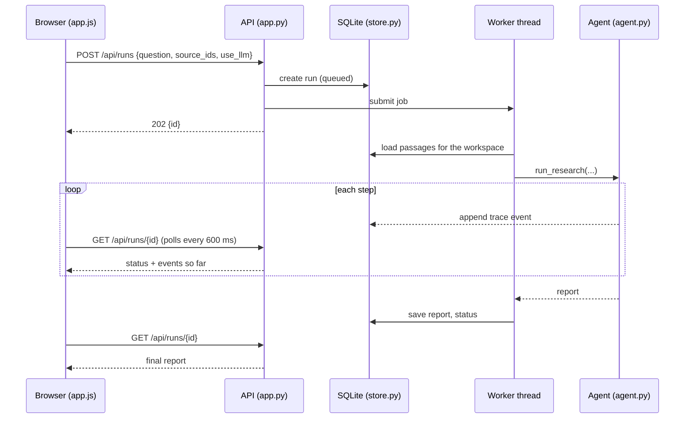

# Architecture

Sourcebound is one Python process: a Starlette application that serves a static front end and a JSON API, runs research jobs in a bounded thread pool, and stores everything in SQLite.

## Data model

| Table | Holds |
| --- | --- |
| `sources` | One row per source: workspace, title, kind (pdf/text/markdown/html/url), origin, size, page count, sample flag |
| `chunks` | ~110-word passages of each source with page numbers; sentences are separated so evidence can be quoted exactly |
| `runs` | Question, status (`queued`, `running`, `complete`, `partial`, `failed`), mode, trace events and the final report JSON |

Every query filters by workspace. Deleting a source cascades to its chunks. Runs interrupted by a restart are marked failed at start-up so the UI never waits forever.

## Ingestion

`ingest.py` parses uploads in memory:

- **PDF** — `pypdf`, page by page; encrypted, image-only, over-long (300+ pages) and malformed files are rejected with specific messages.
- **HTML** — the standard library parser keeps body text, dropping scripts, styles, navigation, headers, footers and forms.
- **Markdown / text** — light Markdown stripping; short unpunctuated lines (headings) become their own paragraphs so they are not glued to the next sentence.

Text is split into sentences (abbreviation-aware) and grouped into chunks with one sentence of overlap, never crossing a page boundary, so every citation can name its page.

## The agent

`agent.py` implements the loop described in the README. Key design choices:

- **Bounded by construction.** A `Budget` object enforces a wall-clock deadline, a tool-call cap, a retry cap per sub-question and a model-call cap. Hitting a limit raises inside the loop, the remaining sub-questions are marked *skipped*, and the report becomes *partial* with an explanation.
- **Tools are plain functions on an allowlist** — `search_sources`, `extract_evidence`, `detect_conflicts`. The model never chooses or calls tools and nothing it returns is executed.
- **Self-evaluation is measurable.** A sub-question is *answered* when its best sentence scores ≥ 0.5 and the evidence covers ≥ 60% of the sub-question's idf-weighted key terms (and contains the expected kind of figure, for "how long / how much / how many" questions). Below that the agent revises the query: first keywords plus pseudo-relevance-feedback terms from the top passages, then the rarest terms alone. *Thin evidence* (score ≥ 0.3, coverage ≥ 30%) is reported as such.
- **Conflicts are deterministic.** `text.extract_figures` normalises money (with million/billion scales), percentages, durations (to months) and counts (keyed by the following noun), skipping dates and bare years. Two figures conflict when they come from different sources, are the same kind and unit, do not overlap (ranges included, 2% tolerance), and are about the same thing — the content words right around each number overlap (or, for durations, the sentences overlap substantially).
- **Verification is mandatory.** `support_level` requires that every number in a sentence appears in its cited evidence and that most of its content terms do. AI drafts that fail too often are rewritten once, then replaced by extractive quotes.

## Front end

`sourcebound/static/` contains the entire UI: `index.html`, `styles.css` and one ES module, `app.js`. There is no framework and no build step; `tsc --checkJs` in strict mode type-checks `app.js` via JSDoc annotations. All server data is inserted with `textContent`, which, together with the Content-Security-Policy, prevents markup in documents from executing.

The workspace key is generated with `crypto.getRandomValues`, stored in `localStorage` (falling back to a per-tab key when storage is blocked) and sent as the `X-Workspace-Id` header.

## API

| Method and path | Purpose |
| --- | --- |
| `GET /api/health` | Liveness and version |
| `GET /api/config` | Public settings: model availability, limits, sample questions |
| `GET /api/sources` | List sources |
| `POST /api/sources/upload` | Multipart upload (`file` field) |
| `POST /api/sources/text` | `{title, text}` |
| `POST /api/sources/url` | `{url}` |
| `POST /api/sources/sample` | Add the fictional sample library |
| `DELETE /api/sources/{id}` | Delete a source |
| `POST /api/runs` | `{question, source_ids?, use_llm?}` → `202 {id}` |
| `GET /api/runs`, `GET /api/runs/{id}` | History; one run with events and report |
| `GET /api/runs/{id}/export.md` / `.json` | Downloads |
| `DELETE /api/runs/{id}` | Delete a finished run |
| `DELETE /api/workspace` | Delete everything in the workspace |

All API calls except health and config require the `X-Workspace-Id` header (32 lowercase hex characters). Errors are JSON `{"error": "..."}` with a message suitable for showing to users.
